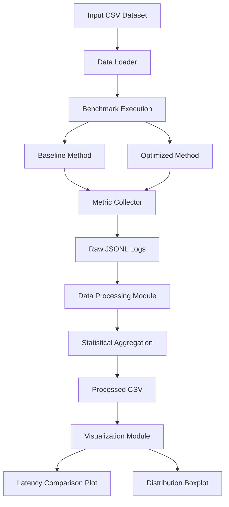

# Domain Model: Performance Benchmarking System

## 1. System Overview

This project compares two data processing methods:

- **Baseline Method:** Pandas groupby and concat.
- **Optimized Method:** Pandas groupby with aggregation.

The system measures execution latency, throughput, memory usage and error rate.

## 2. C4 Component Diagram

## 3. Performance Metrics

### 3.1 Latency

Latency is the time required to complete one benchmark execution.

$$
L_i = t_{end} - t_{start}
$$

Where:
- $L_i$ — execution latency.
- $t_{start}$ — execution start time.
- $t_{end}$ — execution finish time.

**Unit:** milliseconds (ms).

### 3.2 Throughput

Throughput represents the number of requests processed per second.

$$
T = \frac{N}{t}
$$

Where:
- $T$ — throughput.
- $N$ — number of successfully processed requests.
- $t$ — total execution time in seconds.

**Unit:** Requests per second (RPS).

### 3.3 Error Rate

Error Rate measures the percentage of failed benchmark executions.

$$
ER = \frac{N_{failed}}{N_{total}} \times 100\%
$$

Where:
- $N_{failed}$ — number of failed executions.
- $N_{total}$ — total number of executions.

**Unit:** Percentage (%).

### 3.4 Speedup

Speedup measures how many times faster the optimized method is compared to the baseline method.

$$
Speedup = \frac{L_{baseline}}{L_{optimized}}
$$

Where:
- $L_{baseline}$ — baseline method latency.
- $L_{optimized}$ — optimized method latency.

A speedup greater than 1 indicates that the optimized method is faster.
### 3.5 Memory Usage

Memory usage represents the amount of memory consumed during benchmark execution.

It is measured using the peak memory value recorded during each execution.

**Unit:** Megabytes (MB).

### 3.6 Warm-up Measurements

Warm-up executions are performed before evaluation to reduce the effect of initialization and startup overhead.

Warm-up measurements are excluded from the final statistical analysis.

## 4. Statistical Metrics

### 4.1 Mean

The arithmetic average of all measurements.

$$
\bar{x} = \frac{1}{n}\sum_{i=1}^{n}x_i
$$

### 4.2 Median

The middle value of the sorted measurements.

### 4.3 95th Percentile (P95)

The value below or equal to which 95% of measurements fall.

### 4.4 99th Percentile (P99)

The value below or equal to which 99% of measurements fall.

### 4.5 Standard Deviation

Measures the dispersion of measurements around the mean.

$$
SD = \sqrt{\frac{\sum_{i=1}^{n}(x_i-\bar{x})^2}{n-1}}
$$

### 4.6 Bootstrap 95% Confidence Interval

Bootstrap resampling is used to estimate the uncertainty of the median.

The 95% confidence interval is calculated using the 2.5th and 97.5th percentiles of bootstrap median estimates.

## 5. Mathematical Notation Table

| Symbol | Description | Unit / Type |
|---|---|---|
| $L_i$ | Latency of one execution | ms |
| $t_{start}$ | Execution start time | seconds |
| $t_{end}$ | Execution finish time | seconds |
| $T$ | Throughput | RPS |
| $N$ | Total number of executions | Integer |
| $N_{failed}$ | Failed executions | Integer |
| $ER$ | Error rate | % |
| $L_{baseline}$ | Baseline latency | ms |
| $L_{optimized}$ | Optimized latency | ms |
| $SD$ | Standard deviation | ms |
| $P95$ | 95th percentile latency | ms |
| $P99$ | 99th percentile latency | ms |

## 6. Metric Collection Points

1. **Data Loading:** The input CSV dataset is loaded.
2. **Benchmark Execution:** Baseline and optimized methods are executed.
3. **Metric Collection:** Latency, throughput, memory usage and execution status are recorded.
4. **Raw Data Storage:** Measurements are saved in JSONL format.
5. **Data Processing:** Warm-up measurements are removed and statistical metrics are calculated.
6. **Visualization:** Final plots are generated and exported in PDF and PNG formats.
