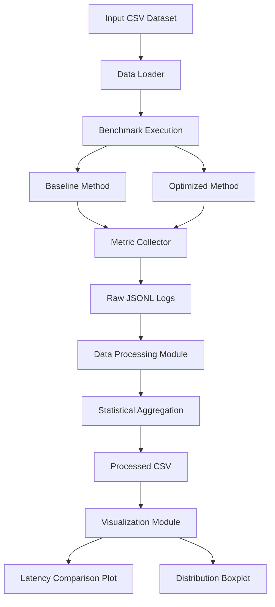

# Domain Model: Performance Benchmarking System

## 1. System Overview

This project compares two data processing methods:

- Baseline Method: Pandas groupby and concat.
- Optimized Method: Pandas groupby with aggregation.

The system measures execution latency, throughput,
memory usage and error rate.

## 2. C4 Component Diagram

## 3. Performance Metrics

### Latency

Execution time required to process one benchmark request.

\[
L_i = t_{end} - t_{start}
\]

Unit: milliseconds (ms).

### Throughput

Number of benchmark requests processed per second.

\[
T = \frac{1}{L_{seconds}}
\]

Unit: Requests per second (RPS).

### Error Rate

Percentage of failed benchmark executions.

\[
ER = \frac{N_{failed}}{N_{total}}\times100\%
\]

### Speedup

Performance improvement of the optimized method.

\[
Speedup = \frac{L_{baseline}}{L_{optimized}}
\]

## 4. Statistical Metrics

- Median: central execution time.
- P95: 95th percentile latency.
- P99: 99th percentile latency.
- Standard Deviation: measurement dispersion.
- 95% CI: bootstrap confidence interval for median latency.

## 5. Metric Collection Points

1. Before execution: input data is loaded.
2. During execution: latency and memory are measured.
3. After execution: throughput and success status are recorded.
4. During processing: warm-up measurements are removed.
5. During analysis: statistical summaries and confidence intervals are calculated.
6. During visualization: final scientific plots are generated.
